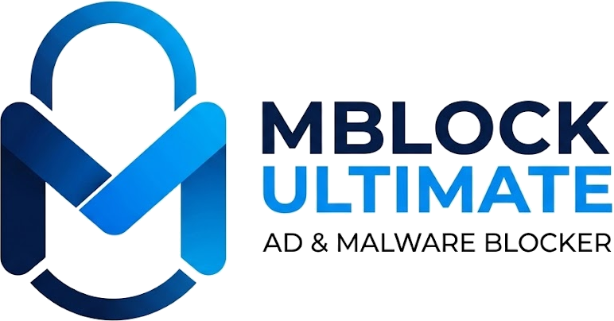

<p align="center">
  
</p>

<p align="center">
  <b>Navega seguro en cualquier sitio, en español.</b><br>
  Bloqueador de anuncios, malware, rastreo y redirecciones para Firefox, por <b>Moldhea</b>.
</p>

<p align="center">
  
  
  
  
</p>

---

## ¿Por qué MBlock Ultimate?

La mayoría de los bloqueadores hacen una sola cosa. Para navegar tranquilo en sitios de streaming, descargas o noticias normalmente necesitas cuatro o cinco extensiones distintas. MBlock Ultimate lo junta todo en una sola y lo deja configurado desde el primer momento:

- 🚫 **Anuncios en cualquier sitio:** YouTube, Facebook, periódicos y blogs. Usa las mismas listas que uBlock Origin y AdGuard (unas 300 000 reglas) y además ejecuta sus scriptlets, que neutralizan los avisos de «desactiva tu bloqueador».
- 🛡️ **Sin redirecciones ni popups:** en los sitios de streaming no oficiales, un clic en «play» ya no abre otra pestaña. Solo se permiten los destinos que tú marcas como seguros o los enlaces visibles en los que haces clic.
- 🦠 **Malware y phishing:** si intentas abrir un sitio peligroso, ves una advertencia antes de que cargue.
- 🍪 **Cookies bajo tu control:** rechaza los banners de cookies automáticamente. Si un sitio solo deja «Aceptar», entras en una **sesión fantasma** y todo lo que guardó se borra al salir.
- 🏠 **Tu red local protegida:** ningún sitio público puede asomarse a tu router ni a otros equipos de tu red.
- 🔕 **Sin spam de notificaciones**, y con la señal *Global Privacy Control* («no vendas mis datos») activada.
- 🇲🇽 **En español:** la interfaz, las listas regionales y los filtros de la comunidad pensados para Latinoamérica.

## Instalación

| Opción | Pasos |
|---|---|
| **Versión firmada** (recomendada) | Descarga el `.xpi` de la [última versión](../../releases/latest) y ábrelo con Firefox. |
| **Desde el código** (temporal) | Clona el repositorio, abre `about:debugging#/runtime/this-firefox` → «Cargar complemento temporal…» → elige `extension/manifest.json`. Se quita al cerrar Firefox. |
| **Para desarrollar** | `npm start` abre Firefox con la extensión cargada y la recarga en cuanto guardas un archivo. |

Requiere Firefox 142 o posterior. Solo funciona en Firefox: usa Manifest V2, que Chrome ya no permite y que es lo que hace posible el bloqueo completo.

## Uso

- **Icono de la barra:** muestra cuántos elementos se bloquearon en la página. Desde ahí puedes desactivar la protección en un sitio, marcarlo como seguro o ver si está en sesión fantasma.
- **Opciones:** activa o desactiva cada función, elige tus listas de filtros, edita tus dominios seguros y escribe tus propios filtros (por ejemplo `sitio.com##.banner` o `||anuncios.xyz^`).
- **Dominios seguros:** son los únicos sitios a los que una página puede abrirte popups o redirigirte sin tu clic. Sirven, por ejemplo, para iniciar sesión con Google o pagar con PayPal. Cada dominio incluye sus subdominios.

La referencia completa de cada función está en [docs/FUNCIONES.md](docs/FUNCIONES.md).

## Privacidad

MBlock Ultimate **no recopila ni envía ningún dato**. Las únicas conexiones que hace son las descargas de las listas de filtros que tienes activadas, sin cookies ni identificadores. Todo lo demás ocurre en tu navegador.

## Limitaciones

- **YouTube cambia su código constantemente.** Las listas se actualizan solas, pero algún anuncio puede colarse unos días.
- **Netflix, Prime Video, Disney+ y Max:** en sus planes con anuncios, el anuncio va dentro del mismo video cifrado que la película. No se puede quitar sin romper la reproducción, y hacerlo viola sus términos de servicio.
- **Faltan algunas funciones avanzadas de uBlock Origin:** los recursos sustitutos (`$redirect=`), los selectores procedurales y algunos scriptlets `trusted-*`.

Ver la lista completa en [docs/FUNCIONES.md](docs/FUNCIONES.md#limitaciones-conocidas).

## Contribuir

Puedes reportar un anuncio que se cuela, un sitio roto o un banner de cookies sin manejar desde [Issues](../../issues/new/choose). Los formularios te piden justo lo necesario.

Para proponer cambios en el código o en los filtros de la comunidad (`filtros/`), lee [CONTRIBUTING.md](CONTRIBUTING.md). El repositorio es abierto, pero **todo cambio necesita la aprobación del mantenedor** antes de entrar a `main` (detalles en [GOBERNANZA.md](GOBERNANZA.md)).

```bash
npm test             # pruebas unitarias
npm run lint         # validación de la extensión (web-ext)
npm run check-lists  # verifica los filtros de la comunidad
npm start            # abre Firefox con la extensión
```

## Versiones

La versión actual es **1.3.0**. Los cambios de cada versión están en [CHANGELOG.md](CHANGELOG.md). Al publicar una etiqueta `vX.Y.Z`, se genera automáticamente una versión firmada.

## Créditos y licencia

MBlock Ultimate es software libre bajo la licencia [GPL-3.0-or-later](LICENSE). © 2026 Moldhea.

Se apoya en el trabajo de la comunidad de bloqueo de contenido: [EasyList](https://easylist.to/), [uBlock Origin](https://github.com/gorhill/uBlock) y [uAssets](https://github.com/uBlockOrigin/uAssets), [AdGuard Filters](https://github.com/AdguardTeam/AdguardFilters), [malware-filter](https://gitlab.com/malware-filter), [Peter Lowe's list](https://pgl.yoyo.org/adservers/), [Consent-O-Matic](https://github.com/cavi-au/Consent-O-Matic) y [DuckDuckGo autoconsent](https://github.com/duckduckgo/autoconsent). Cada lista conserva su propia licencia.
